# What affects a footballer's market value?

Exploratory analysis and a linear regression model of Transfermarkt data, built with pandas, numpy, seaborn and statsmodels.

**Scope:** players currently at a Premier League club (2025/26), using the last 5 seasons of data (2021/22 to 2025/26). That gives 729 players and 2,669 player-seasons, each with the player's last market value of the season.

## Setup

```powershell
python -m venv .venv
.venv\Scripts\Activate.ps1
pip install -r requirements.txt
```

Then put the three Transfermarkt CSVs in `data/raw/` (see `data/raw/README.md`) and run the notebooks in order.

## Structure

```
data/raw/         original CSVs (not tracked by git)
data/processed/   cleaned player-season table (not tracked)
notebooks/        01 data overview, 02 cleaning and features, 03 EDA, 04 linear regression
src/              reusable code (config, loading, features, plots, modeling)
reports/figures/  saved charts
```

## Findings

### What goes with a higher market value

**1. Value peaks in the mid-20s.** The median value is flat at about €22M from age 25 to 27, then falls steadily: about €12M at 30 and €4M at 33.

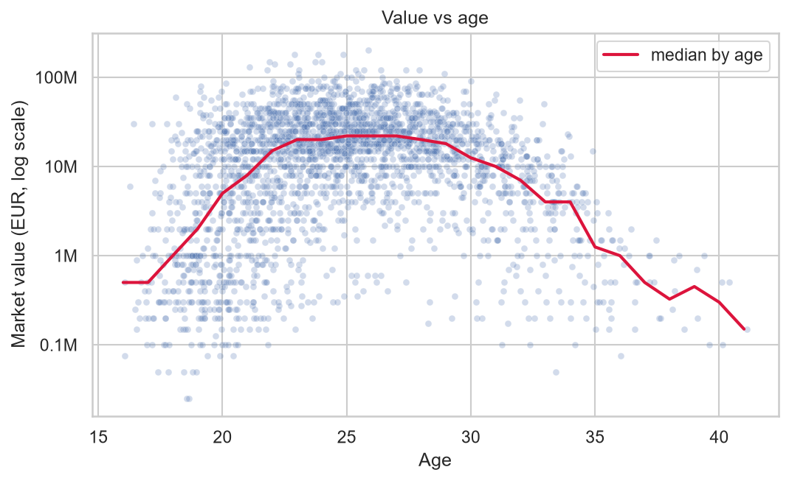

**2. Attackers are valued slightly higher than other outfield players; goalkeepers are far lower.** The median attacker is worth €17M, against €15M for defenders and midfielders and about €3M for goalkeepers. Left wingers have the highest median of any sub-position (€20M).

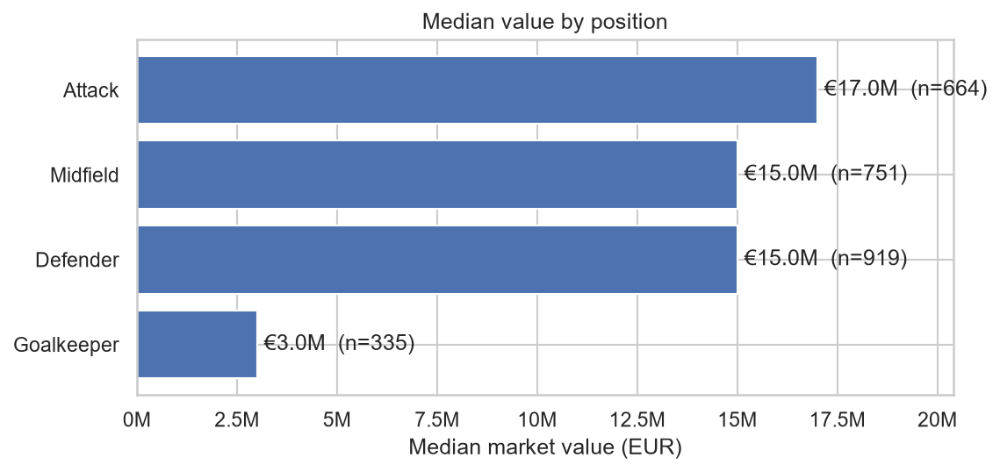
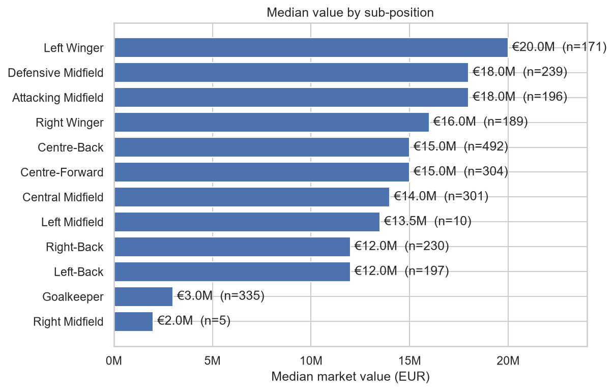

**3. Bigger, richer clubs have more valuable squads.** Arsenal (€45M), Manchester City (€40M) and Chelsea (€28M) have the highest median player values; the newly promoted clubs sit lower (Leeds €12M, Sunderland €10.5M, Burnley €5M). It is not a simple ladder, though: Manchester United and Everton are well above Aston Villa.

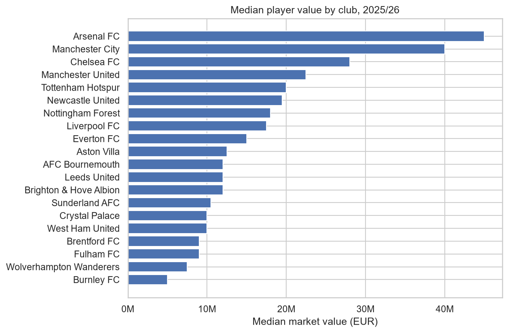

**4. Playing time matters.** Median value rises from about €8M for players with under 450 Premier League minutes to €16M, €22M and €30M for 2,250+ minutes (correlation 0.51). Part of this is quality, since better players get picked more.

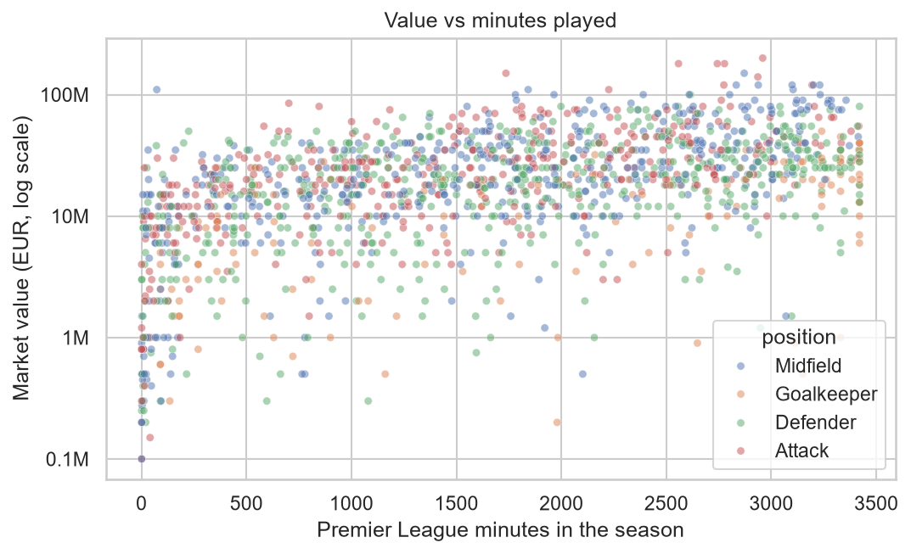

**5. Goals and assists matter, mostly for attackers and midfielders.** Goals and assists per 90 each correlate about 0.29 with value; the link is stronger for attackers and midfielders than for defenders.

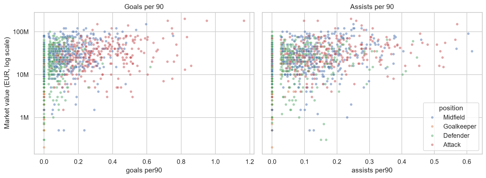

**6. Last season's value is a very strong predictor.** The correlation between last season's and this season's log value is 0.87.

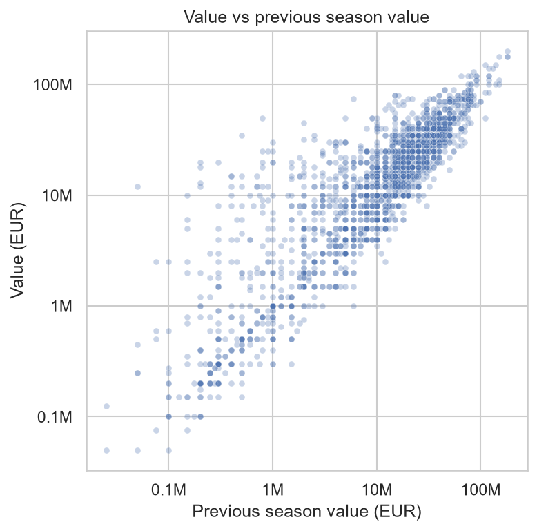

**7. Height and foot barely matter.** Taller players (185 cm and over) have a lower median value, probably because goalkeepers and centre-backs are tall. Left-footers are slightly above right-footers.

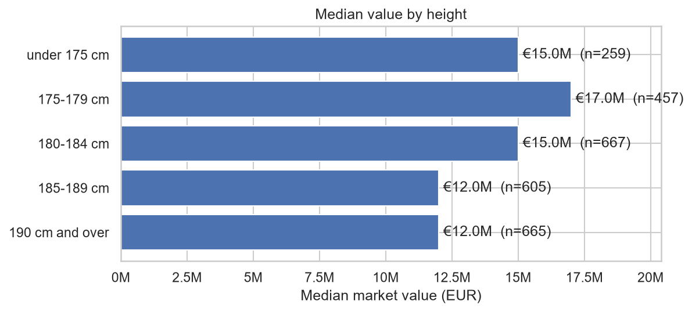
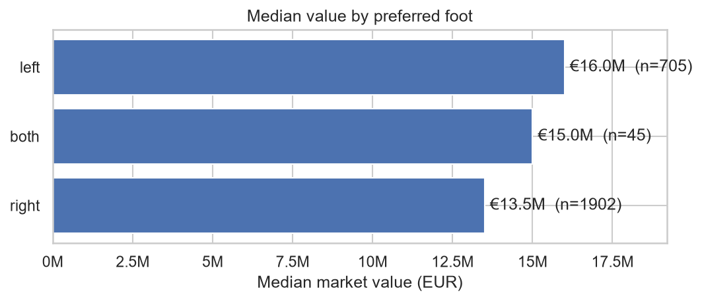

**8. Correlations.** The strongest links with value are appearances (0.54), minutes (0.51) and starts (0.49), followed by goals and assists. Age and height are near zero in a straight-line correlation, but age matters as a curve (finding 1). Appearances, minutes and starts overlap heavily.

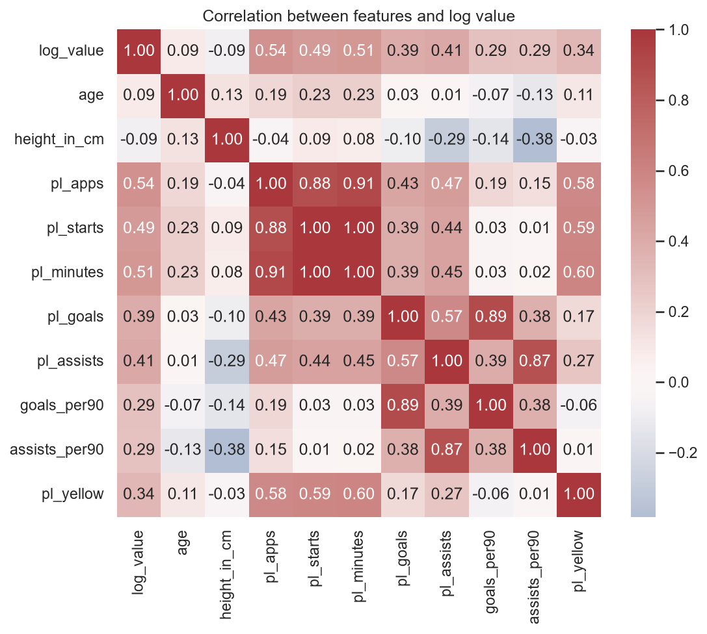

### How well can a linear regression predict value?

The model predicts the log of market value. It is trained on seasons 2021/22 to 2024/25 and tested on 2025/26 (players it has not seen for that season).

| Model | R² | Typical error |
|---|---|---|
| With last season's value, profile and Premier League performance (B) | 0.87 | about €4M (22%) |
| No last value, with performance (B0) | 0.68 | about €7M (36%) |
| No last value, no performance (A0) | 0.55 | about €8.6M (41%) |
| Naive guess: same as last season | 0.64 | about €6M (33%) |

All four are scored on the same 381 test players. R² is the share of the variation in value the model explains.

- **Last season's value does much of the work.** Dropping it takes the typical error from 22% to 36%, and the model is then no better than the naive guess.
- **Performance carries real weight.** Without last value, adding minutes, goals and assists lifts R² from 0.55 to 0.68.
- **Roughly two thirds of the variation can be explained** from age, position, height, foot and Premier League output. The rest comes from things this data does not capture, such as reputation, contract length, club and transfer demand.
- **Age is a curve.** With performance held fixed, a 30-year-old is valued about 49% below a 25-year-old and a 33-year-old about 76% below (model B0).
- **Minutes, goals and assists all have clearly positive effects.** Foot has no meaningful effect and height only a small one.

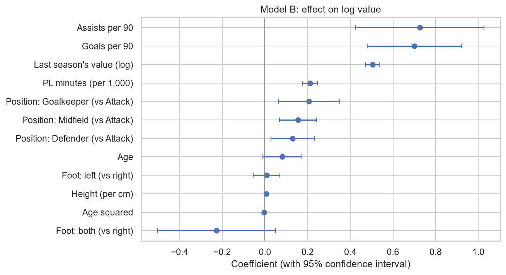

The model is weakest at the top: all ten biggest misses are under-predictions of stars (for example Rice: €120M actual, about €78M predicted), because a linear model pulls extreme values towards the average.

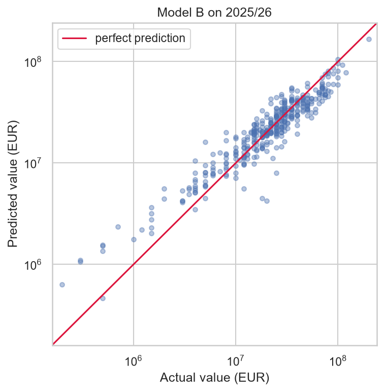

### Limits

- Only players currently in the Premier League are included, so the conclusions apply to them, not to all footballers.
- Results are associations, not causes.
- The test set is a single season (381 players), so the exact numbers could shift with a different split.
- A player's seasons are not independent of each other.
